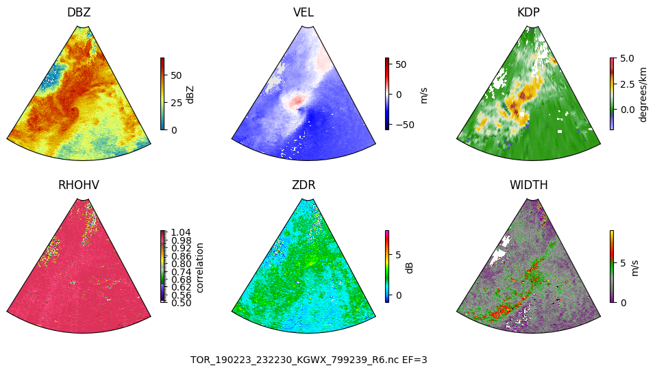

# TorNet hybrid

Tornado detection on the [TorNet](https://doi.org/10.1175/AIES-D-24-0006.1) benchmark: the MIT Lincoln
Laboratory CNN baseline, repackaged, plus work toward a CNN–transformer hybrid built on it.

This is a fork of [mit-ll/tornet](https://github.com/mit-ll/tornet). The data loaders, preprocessing,
CNN baseline, metrics and plotting code are the authors' work and keep their license and
distribution notices. What differs from upstream is recorded in [`CHANGES.md`](CHANGES.md); the
original README is kept at [`references/upstream-README.md`](references/upstream-README.md).

> Veillette, M. S., J. M. Kurdzo, P. M. Stepanian, J. Y. N. Cho, T. Reis, S. Samsi, J. McDonald, and
> N. Chisler, 2025: A Benchmark Dataset for Tornado Detection and Prediction Using Full-Resolution
> Polarimetric Weather Radar Data. *Artificial Intelligence for the Earth Systems*, 4(1), e240006.
> [doi:10.1175/AIES-D-24-0006.1](https://doi.org/10.1175/AIES-D-24-0006.1)

Pretrained baseline weights: [tornet-ml/tornado_detector_baseline_v1](https://huggingface.co/tornet-ml/tornado_detector_baseline_v1).
Project notes, the verified baseline architecture, and the hybrid design: [`docs/project.md`](docs/project.md).



## Setup

Requires [uv](https://docs.astral.sh/uv/) and Python 3.12 (pinned in `.python-version`).

```
uv sync
```

That installs the package, Keras 3 on the torch backend, the Hugging Face client, and the dev tools.
Add `--extra notebooks` for Jupyter. Torch is the backend everywhere: PyPI tensorflow wheels carry no
kernels for Blackwell GPUs, and the model is pure Keras ops, so the architecture is identical on any
backend.

## Data

TorNet is distributed as one archive per year on Zenodo, about 150 GB in total. Each archive holds
both `train/YYYY/` and `test/YYYY/`, so any subset of years carries its own held-out test files.

| Year | Record | Size |
|---|---|---|
| 2013 + `catalog.csv` | [12636522](https://doi.org/10.5281/zenodo.12636522) | 3 GB |
| 2014 | [12637032](https://doi.org/10.5281/zenodo.12637032) | 15 GB |
| 2015 | [12655151](https://doi.org/10.5281/zenodo.12655151) | 17 GB |
| 2016 | [12655179](https://doi.org/10.5281/zenodo.12655179) | 16 GB |
| 2017 | [12655183](https://doi.org/10.5281/zenodo.12655183) | 15 GB |
| 2018 | [12655187](https://doi.org/10.5281/zenodo.12655187) | 12 GB |
| 2019 | [12655716](https://doi.org/10.5281/zenodo.12655716) | 18 GB |
| 2020 | [12655717](https://doi.org/10.5281/zenodo.12655717) | 17 GB |
| 2021 | [12655718](https://doi.org/10.5281/zenodo.12655718) | 18 GB |
| 2022 | [12655719](https://doi.org/10.5281/zenodo.12655719) | 19 GB |

Zenodo throttles single connections; `aria2c` with many connections is 10–100× faster than a browser
or `zenodo_get`:

```
mkdir -p ~/data/tornet && cd ~/data/tornet
aria2c -x16 -s16 -k1M -o tornet_2013.tar.gz "https://zenodo.org/records/12636522/files/tornet_2013.tar.gz?download=1"
aria2c -x16 -s16 -k1M -o catalog.csv        "https://zenodo.org/records/12636522/files/catalog.csv?download=1"
tar -xzf tornet_2013.tar.gz
export TORNET_ROOT=~/data/tornet
```

`scripts/runpod/download_tornet.sh` does all ten years unattended with checksum verification. After
extraction `TORNET_ROOT` should contain `catalog.csv`, `train/` and `test/`.

## Commands

| Command | What it does |
|---|---|
| `tornet-train <config.json>` | Train the CNN baseline. Writes `experiments/<exp_name>_<timestamp>/` with `results.json`, `history.csv`, and `checkpoints/best.keras` + `last.keras`. |
| `tornet-test` | Evaluate a `.keras` model on the test partition. `--years` restricts years, `--output` saves scores, `--predictions` saves per-sample logits. Downloads the pretrained weights if no `--model_path` is given. |
| `tornet-score <preds.csv> [...]` | Score prediction files offline: the paper's three test views, bootstrap CIs, best-threshold CSI, recall by EF rating, AUC by year, and a paired comparison between models. |
| `tornet-results [--group]` | Tabulate every `results.json` under `experiments/`, averaging folds per experiment. |

All configs live in `configs/`. `tornado_baseline.json` is the authors' hyperparameters; the rest are
ours. Unknown keys are ignored, so configs carry a `_note`.

## Local iteration on a subset

The paper's protocol is five year-pair folds inside the training partition for hyperparameter
selection, then a retrain on all training years, then one evaluation on the test partition. The
configs mirror that on 2013–2015 as three folds, each holding out one year:

```
export TORNET_ROOT=~/data/tornet
uv run pytest                                   # dataset tests run when the catalog is present
uv run tornet-test --years 2013 2014 2015 --output scores_pretrained.json --predictions preds_pretrained.csv
uv run tornet-train configs/fold_a.json         # train 2014+2015, validate 2013
uv run tornet-train configs/fold_b.json         # train 2013+2015, validate 2014
uv run tornet-train configs/fold_c.json         # train 2013+2014, validate 2015
uv run tornet-results --group                   # baseline score = fold-averaged validation AUC
uv run tornet-train configs/final.json          # retrain on all three years, no validation
uv run tornet-test --model_path experiments/latest/checkpoints/last.keras --years 2013 2014 2015 --predictions preds_final.csv
uv run tornet-score preds_pretrained.csv preds_final.csv
```

A model variant is the same configs under a new `exp_name` prefix. Subset scores sit below the
paper's because there is less training data and a higher tornado base rate; compare variants against
the baseline on the same subset, not against the published numbers. Scaling to the full dataset is
the same commands with all ten years in the config.

## Layout

```
src/tornet/
├── data/        loader.py (NetCDF reader, catalog query), preprocess.py, keras_loader.py, constants.py
├── models/      cnn_baseline.py (build_model), layers.py (CoordConv2D, FillNaNs), losses.py
├── metrics.py   logit-aware precision, recall, F1
├── display/     radar plotting
├── scripts/     the four commands
└── utils/       experiment directories, git revision
configs/         training configs
tests/           synthetic-data tests (no download needed) plus dataset tests
notebooks/       DataLoaders.ipynb, VisualizeSamples.ipynb
docs/            project.md, figures
references/      the paper, the upstream README
results/         pretrained-model predictions and scores on 2013–2014 (reference)
scripts/runpod/  full-dataset download script
```

## Development checks

```
uv run ruff format && uv run ruff check   # format and lint
uv run ty check                           # type check (advisory)
uv run pytest                             # 37 tests without the dataset, 41 with it
```

## License

MIT, see [`LICENSE`](LICENSE). The upstream code carries the following notice in each file:

> DISTRIBUTION STATEMENT A. Approved for public release. Distribution is unlimited.
> This material is based upon work supported by the Department of the Air Force under Air Force
> Contract No. FA8702-15-D-0001. Any opinions, findings, conclusions or recommendations expressed in
> this material are those of the author(s) and do not necessarily reflect the views of the Department
> of the Air Force. © 2024 Massachusetts Institute of Technology. Delivered to the U.S. Government
> with Unlimited Rights, as defined in DFARS Part 252.227-7013 or 7014 (Feb 2014).
